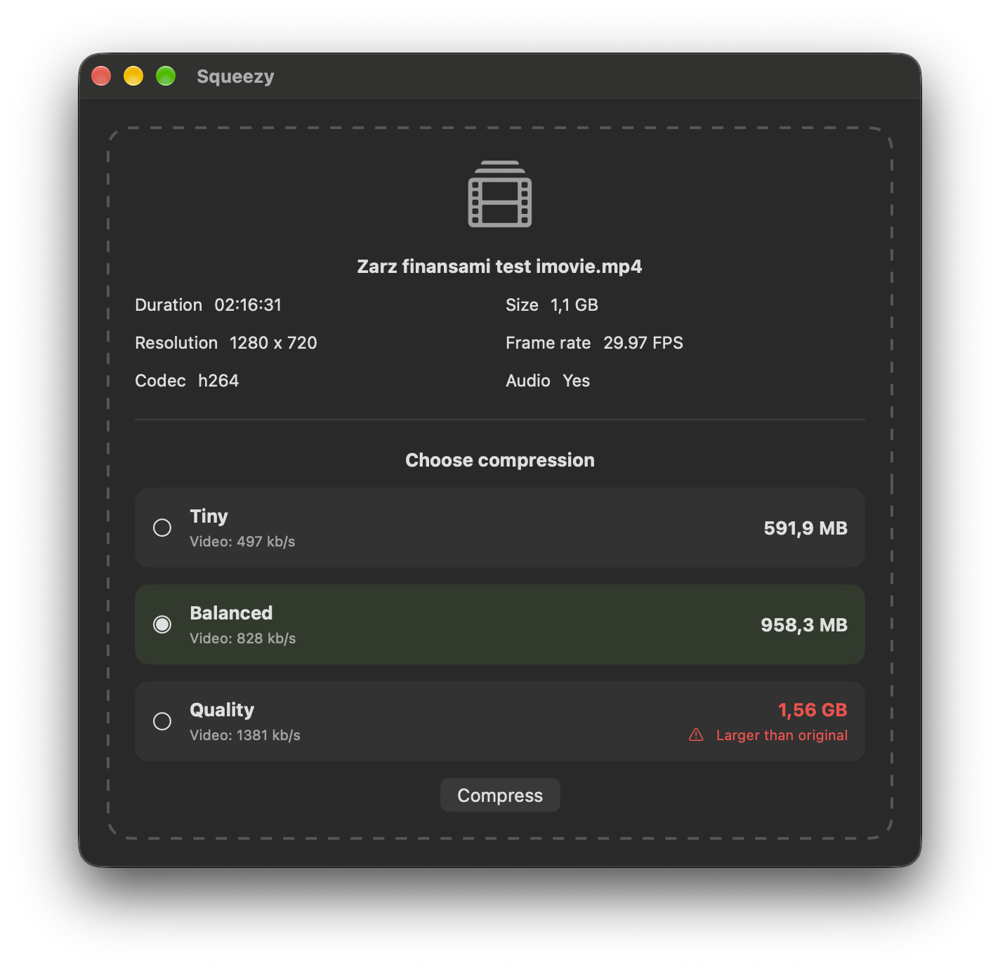

# Squeezy

A tiny, native macOS video compressor. Gloriously powered by [FFmpeg 👑](https://www.ffmpeg.org/).

No cloud, no accounts, no subscriptions.

<p align="center">
  
</p>

## Why?

I built it for my partner, who records university lectures, and needs to turn the
multi-GB files into something smaller. You know, memory prices...

Online compression services mean uploading large files, dealing with privacy concerns,
size limits, subscriptions, and other bullshit. And everyone is usually running FFmpeg
behind the scenes anyway.

So why not use FFmpeg locally, with an interface that doesn't require what a video bitrate
is?

That's Squeezy. A small, intentionally simple graphical wrapper around FFmpeg.

## Features

- Native macOS interface build with SwiftUI with drag and drop
- Three compression presets - Tiny, Balanced, and Quality
- Estimated output sizes and warnings for potentially larger files
- HW accelerated HEVC encoding using Apple VideoToolbox
- Live progress with estimated remaining time and compression strength
- Local processing with bundled FFmpeg: what you do on your Mac, stays on your Mac

## Installation

Squeezy is designed for Macs with Apple Silicon.

Download the latest release from GitHub Releases page, install the application, and launch
it. FFmpeg and ffprobe are included in application bundle.

## Building from source

Requirements: Xcode, Apple Command Line Tools, GPG, and standard build tools on an Apple
Silicon Mac.

```
./scripts/build-ffmpeg.sh
```

The script downloads and verifies the pinned FFmpeg release, builds a minimal ARM64
configuration, and installs the executables into the project.

Open Squeezy in Xcode and build.

## Limitations

Squeezy supports a limited set of codecs and containers (MP4, MOV, and MKV). Output size
estimates are approximate, and the three presets prioritize simplicity over detailed
encoder controls.

Squeezy is as unprofessional as it gets. If you need advanced encoding options, use
FFmpeg directly.

## License

Squeezy is released under the MIT License. Use it, fork it, change it, or build something
entirely different. Just preserve the original copyright and license notice.

FFmpeg is developed by its respective contributors and is distributed under its own
license terms. Squeezy is not affilated with the FFmpeg project. See third-party notices
for licensing and redistribution details.

## Acknowledgements

Thanks to the FFmpeg developers for building the software that makes this little application
possible.

And to my partner, for providing an excellent excuse to write a macOS application that probably
didn't neet to exist.

